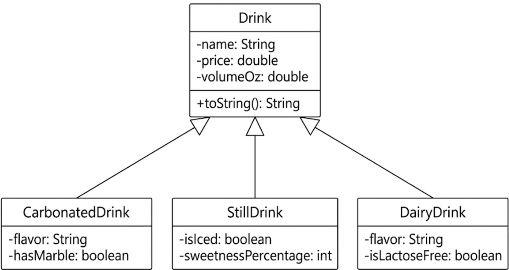

# Store-Management-Project

# Unit 2 - Store Management Project

## Introduction

You are opening a new business in your community! Businesses often need programs to manage the products and services they offer and track orders and requests from customers. Your goal is to create a store management system for your business.

## Requirements

Use your knowledge of object-oriented programming and class structure and design to create your store management system:
- **Create a class hierarchy** – Develop a superclass that represents a product or service your business offers and one or more subclasses that extend the superclass to represent more specific types of products or services.
- **Declare instance variables** – Declare instance variables in the superclass that are shared with the subclasses and instance variables in the subclasses that are not shared with the superclass.
- **Write constructors** – Write no-argument and parameterized constructors in the superclass and subclasses. Subclass constructors use the super keyword to call the superclass constructor.
- **Implement accessor and mutator methods** – Write accessor and mutator methods for instance variables that should be accessible and/or modifiable from outside of the class.
- **Implement a toString() method** – Write toString() methods in the superclass and subclasses that return information about the state of an object.

## UML Diagram

Embed your UML Diagram here. Upload the image of your UML Diagram to your repo, then use Markdown to insert your image here:

## Description

1. Write a description of your project here. Include what your store you made, and why you chose this topic. In your description, include as many vocab words from our class to explain how you represented the item/service from your store. If you have user input, explain how the user will interact with your store such as which questions are prompted to the user, what response is your program expecting, and how that is used to output information for your store in the console.

This project is for a Drink Store superclass that has the subclasses of carbonated riks, dairy drinks, and still drinks. The carbonated drinks consist of Ramune and Sprite, the dariy drinks consist of chocolate and strawberry milk, and the still drinks are lemonade and water. All of these subclasses/drinks print out the flavor, sweetness percentage, volume, and price. This is all put into the program using super, superclasses and subclasses/inheritance, this, instance variables, methods, and more. 

2. How is this project related to STEAM (Science, Technology, Engineering, Art, and Mathematics)? Provide explicit examples from the project and details as possible.

This project is related to various aspects of STEM. For example, technology is definitely the main one as this was a completely digital project and is completely reliant on the tech used for coding. Just the fact it was completed on Code.org and I am using GitHub adds in that tech aspect. Furthermore, a form of mathematics was used as I had to incorporate some operations for the prices of my drinks and used those symbols. Along with this, art could have been slightly incorporated into the planning as I created a UML diagram as shown above that helped me clear my thoughts and get a good start to how I would format my program and what super and subclasses I would be using. 

3. What SLOs did you demonstrate during completing this project?

While building this drink shop project, I learned how to use object-oriented programming to keep my code organized. I practiced creating a class hierarchy by making a main Drink superclass and three specific subclasses, using private variables along with getter and setter methods to keep data safe. I also wrote different constructors using the super keyword, added toString() methods to easily print out each drink's details, and used comments and a UML diagram to document my system design.
